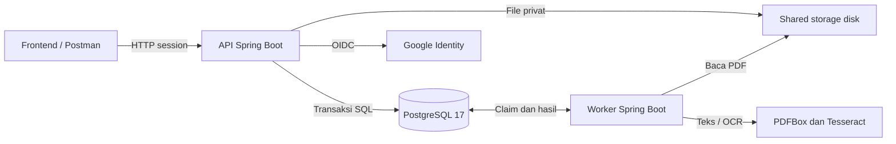
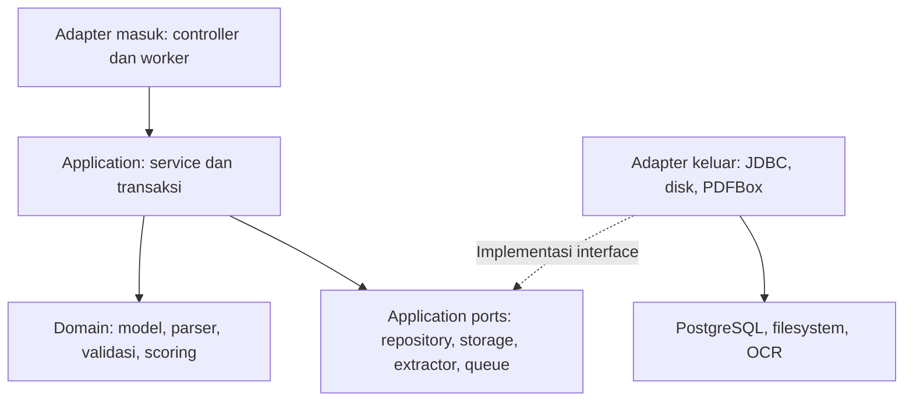
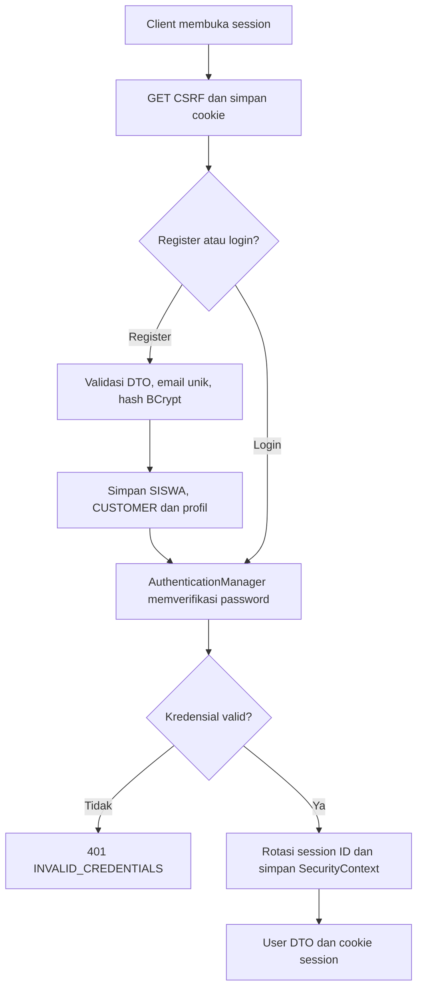
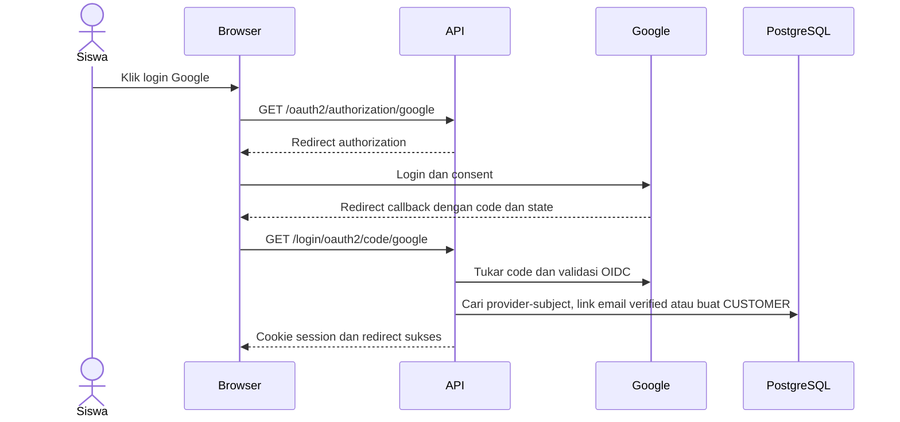
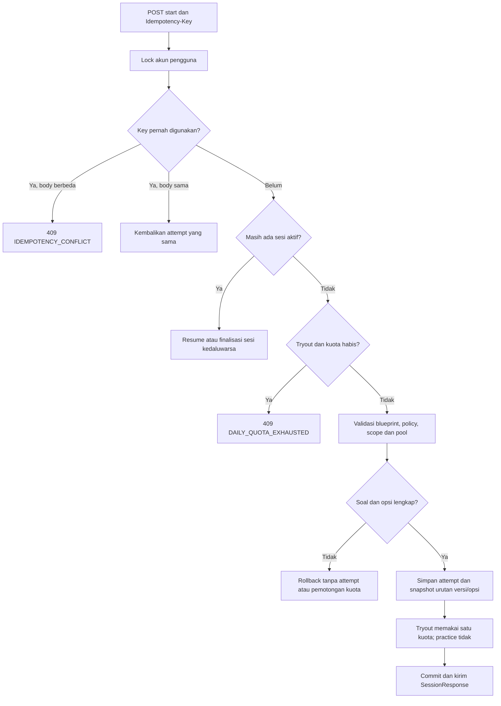
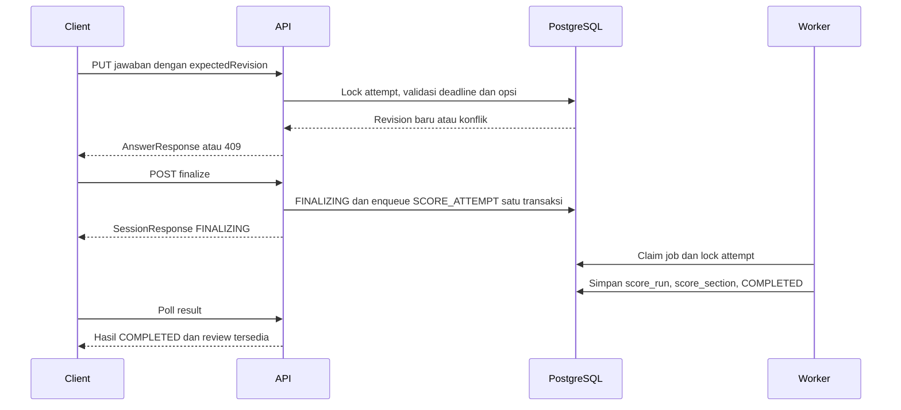
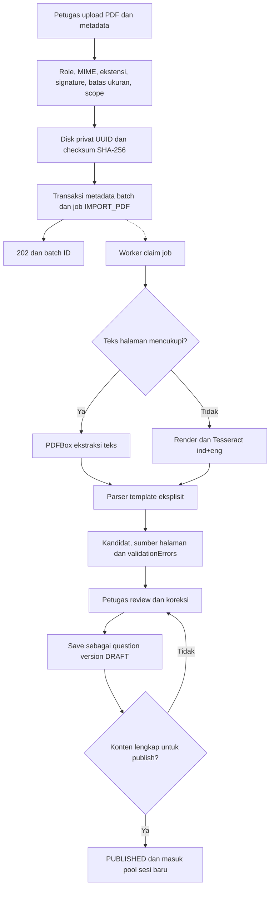
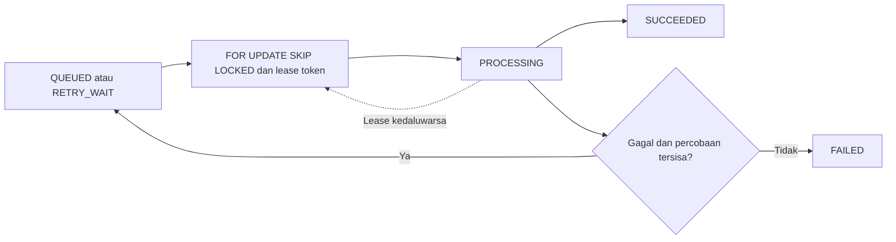

# Arsitektur dan alur backend

[Indeks dokumentasi](README.md) · [Model data](02-database.md) · [API](03-api-reference.md)

## Runtime

Compose mempunyai tiga service: `postgres`, `api`, `worker`. API dan worker memakai image yang sama,
namun worker memakai profil `worker`, mengaktifkan scheduler dan tidak membuka HTTP listener publik.
API menjalankan HTTP di port container 8080. Flyway berjalan saat startup; PostgreSQL mengunci proses migrasi
agar dua proses tidak menerapkan versi yang sama bersamaan.

Antrean memakai tabel `job`, bukan broker terpisah. Redis, S3/object storage, message broker, gateway payment,
SMTP dan reverse proxy produksi belum terintegrasi. Session masih berada di memori proses API.

## Layer dan arah dependensi

| Layer | Tanggung jawab aktual | Contoh |
|---|---|---|
| `domain` | Aturan/struktur nilai untuk konten dan scoring; tidak mengakses HTTP/JDBC | `QuestionValidator`, `TemplateQuestionParser`, `ScoreCalculator` |
| `application` | Orkestrasi, transaksi dan port, request/response DTO | `ExamService`, `ContentImportService`, `ExamRepository` |
| `adapter/in/web` | Validasi body/path/header, auth principal, pemetaan status HTTP | `ExamController`, `ContentController` |
| `adapter/in/worker` | Scheduler, dispatch job, pencatatan keberhasilan/kegagalan | `LearningWorker` |
| `adapter/out` | SQL bernama dan mapping DTO internal; disk/PDF/OCR | `JdbcExamRepository`, `LocalImportFileStorage`, `PdfBoxExtractor` |
| `shared` | Security, CSRF, korelasi log, error API, clock/config | `SecurityConfiguration`, `ApiExceptionHandler` |

Modul yang sudah berisi logic: `identity`, `exam`, `content`, `operations`, `system`.
Catalog/read API dan scoring saat ini berada di `exam`; belum menjadi service atau modul assessment terpisah.
Pola ini memisahkan tanggung jawab, tetapi belum merupakan isolasi modul yang sepenuhnya dipaksakan oleh build.
Beberapa model aplikasi/domain masih memakai `JsonNode`, anotasi validasi atau exception HTTP bersama.
Roadmap mencantumkan penyempurnaan batas tersebut tanpa mengubah kontrak frontend.

DTO request/response mendefinisikan key satu per satu. Projection internal repository tidak dikirim langsung
sebagai data kredensial. `stem`/`content`/`details` menggunakan JSON terstruktur untuk bagian yang fleksibel.
SQL berada pada adapter persistence dan memakai named parameter, bukan string gabungan dari input pengguna.

## Identitas, tipe pengguna dan hak akses

`user_type` adalah klasifikasi produk, saat ini default `SISWA`. `user_role` adalah izin; satu akun bisa mempunyai
beberapa role. Pendaftaran publik tidak menyediakan pilihan role dan selalu memberi `CUSTOMER`.
Kode role yang disiapkan: `CUSTOMER`, `QUESTION_STAFF`, `PLATFORM_ADMIN`.

| Kelompok endpoint | Penjagaan aktual |
|---|---|
| Health, CSRF, Swagger/OpenAPI, redirect/callback OAuth | Publik sesuai konfigurasi Security |
| Register/login password | Publik, tetapi POST tetap wajib CSRF dan cookie session yang cocok |
| Profil, katalog/read API, riwayat, quota, subscription, leaderboard, baca soal/asset | Session terautentikasi; endpoint data pribadi dibatasi akun/attempt terkait |
| Start, resume/navigator, autosave, finalize, result/review | `CUSTOMER` melalui method security dan pemeriksaan kepemilikan |
| Seluruh `/api/v1/staff/**` | `QUESTION_STAFF`; petugas bisa melihat daftar konten/impor petugas lain |
| Admin | Kode role tersedia; API admin lengkap belum dibuat |

`PLATFORM_ADMIN` bukan superuser otomatis. Agar akun admin membuka konten, akun tersebut harus diberi
`QUESTION_STAFF` secara eksplisit. Sejumlah read API lama hanya mengecek authenticated, belum role `CUSTOMER`;
penyamaan policy read API dicatat sebagai pekerjaan penguatan akses.

### Login/register password

Register mendapat `201`, login `200`. Tidak ada access/refresh JWT pada response aplikasi. Cookie server
adalah identitas session. Default idle timeout 30 menit, dapat diubah melalui `SESSION_TIMEOUT`.
Restart/recreate API menghapus session. Logout menghapusnya segera.

### Google OAuth2/OIDC

Profil `oauth` menambahkan provider Google dengan scope `openid,profile,email`. Service menolak email tidak
verified dan akun lokal tidak aktif. Akun baru SSO boleh memiliki `password_hash=NULL`; akun tersebut tidak
otomatis dapat login password. Saat subject belum terhubung, service saat ini dapat menautkan akun berdasarkan
email Google yang verified. Penguatan/persetujuan kebijakan linking dicatat sebelum peluncuran produksi.
Client Secret hanya berada di konfigurasi server; jangan dimasukkan ke frontend, Postman atau dokumentasi.
OAuth state/nonce menjaga proses login/callback. CSRF token menjaga mutasi aplikasi yang memakai cookie session;
mengaktifkan Google SSO tidak menghapus kebutuhan CSRF untuk profil, jawaban, upload atau logout.

## Start tryout/practice

Lock akun dan unique index sesi aktif mencegah dua start paralel. Key berlaku per user; body hash mencakup
mode, target dan jumlah soal. Replay bukan membuat sesi baru, walaupun sesi lama sudah selesai.
Bila key baru dikirim sementara sesi aktif/finalizing masih ada, response tetap sesi itu dan key baru belum
dipakai untuk attempt baru. Client harus membaca `mode`, `tryoutId` dan `status` response.

Tryout: paling banyak dua start baru per hari WIB. Practice: 1–50 soal, durasi teknis dua menit per soal,
blueprint internal per kombinasi topik/jumlah, tanpa pemotongan kuota tryout. Durasi ini belum konfigurasi produk terpisah.
Keduanya berbagi satu sesi `IN_PROGRESS`/`FINALIZING`.

Pool memakai versi PUBLISHED terbaru per soal, tidak diarsipkan, cocok subtes/topik/tahun. Pemilihan mengutamakan
belum dilihat lalu paparan tertua. Pada tryout baru, soal yang dilihat pada hari WIB yang sama dikeluarkan;
query exposure saat ini juga mencakup practice. Soal diacak setelah pool dipilih. Opsi diacak hanya jika
`shuffle_allowed=true`. Section yang bertumpang tindih sehingga memilih soal sama ditolak, bukan dicari ulang.

`ready` pada detail katalog menggambarkan stok global, belum stok personal sesudah filter paparan harian.
Karena itu `ready=true` belum menjamin start pengguna tertentu berhasil.

## Autosave, deadline dan penilaian

Revision awal belum ada jawaban adalah 0; penyimpanan pertama menjadi 1. Update berikutnya wajib membawa
revision terakhir. `selectedOptionId=null` mengosongkan pilihan; jawaban bisa tetap ditandai flagged.
Server memvalidasi opsi milik versi soal tersebut. Waktu client tidak menentukan apakah jawaban diterima.

Finalize biasa, abandon dan deadline sama-sama menuju `FINALIZING`, dengan terminal reason
`SUBMITTED`, `ABANDONED` atau `TIMED_OUT`. Worker mencari maksimal 100 sesi kedaluwarsa per tick;
GET sesi/hasil tertentu juga dapat memfinalisasi sesi yang sudah kedaluwarsa.
Request answer terlambat ditolak, lalu worker/read sesi menutup statusnya.

Hasil yang belum ada: `totalScore=null`, `sections=[]`; UI menampilkan menunggu pemrosesan.
Review hanya setelah COMPLETED. Baca satu soal juga membuang kunci/pembahasan sampai ada score_run.
Sesi abandon tetap menghabiskan kuota dan boleh memiliki hasil pribadi.

### Rumus penilaian yang tersedia

- BINARY: poin benar/salah/kosong dari policy; default 1/0/0. Maksimum per soal adalah `correctPoints`.
- OPTION_WEIGHT: poin opsi terpilih; maksimum per soal adalah bobot opsi tertinggi. Opsi kosong memakai `emptyPoints` default 0.
- `totalScore = jumlahPoin × scale / jumlahMaksimum`, dibulatkan 4 desimal HALF_UP.
- Akurasi section = benar/jumlah soal × 100, terpisah dari nilai berbobot.
- Policy awal hanya mendukung agregasi SUM, rounding HALF_UP dan rule yang dikenali; selain itu start ditolak.

Ini indeks latihan PastiSiap, bukan nilai resmi UTBK/IRT atau keputusan kelulusan. Sesi acak tidak otomatis
menjadi leaderboard kompetisi karena belum memakai form/cohort sebanding.

## PDF menjadi bank soal

Input parser: nomor soal, opsi A–E, `Kunci: B`, `Pembahasan: ...`. Missing/ambiguity tidak ditebak.
Draft koreksi disimpan terpisah dari hasil ekstraksi agar provenance tetap terlihat. Simpan kandidat idempoten;
setelah tersimpan, perubahan dilakukan sebagai versi master baru. Publish tidak otomatis dilakukan worker.
Versi DRAFT terbaru tidak menghilangkan versi PUBLISHED lama dari pool sampai versi baru diterbitkan.

PDF sumber bisa mengandung kunci, sehingga role siswa tidak mendapat akses sumber. Asset siswa menggunakan
purpose `QUESTION_ASSET`; sumber menggunakan `IMPORT_SOURCE` dan diblokir menjadi asset siswa.
API upload asset gambar/biner terpisah belum tersedia. File yang sudah terdaftar dapat dibaca melalui endpoint asset.

## Worker dan batas transaksi

Polling default tiap dua detik; satu job dikerjakan per tick. Retry menunggu 10 detik, maksimum default lima
percobaan menurut kolom job, lease 15 menit. Worker tidak memiliki API retry manual. Job gagal permanen membutuhkan
investigasi operator; attempt dapat tetap FINALIZING tanpa menampilkan skor nol.

Token lease mencegah worker lama menandai sukses/gagal atas job yang sudah dimiliki worker baru. Commit hasil
impor juga memverifikasi lease. Scoring sendiri mengunci attempt dan berhenti jika sudah COMPLETED; commit score
aman diproses ulang setelah worker crash sebelum status job berhasil ditulis.

| Use case | Batas transaksi |
|---|---|
| Register | Simpan akun + role, trigger membuat profil; pembuatan HTTP session berlangsung setelah register |
| Start | Lock akun, replay/active check, pool, attempt/items dan kuota berada pada satu transaksi |
| Answer | Lock attempt dan update bersyarat revision |
| Finalize | Perubahan status + enqueue scoring atomik |
| Score | Lock attempt, score_run/sections dan COMPLETED atomik |
| Upload | Tulis file dahulu; transaksi metadata + batch + job; cleanup file bila gagal/duplikat |
| Import extract | Ekstraksi/OCR di luar transaksi panjang; commit kandidat dengan lease guard |
| Candidate/save/publish/version/archive | Transaksi database; beberapa mutasi menulis audit_event |

Filesystem dan PostgreSQL tidak membentuk transaksi terdistribusi. Crash di sela upload dapat meninggalkan
file orphan; rekonsiliasi/retensi storage dan backup terkoordinasi masih pekerjaan operasional berikutnya.
Audit konten sudah ada, tetapi koreksi kandidat dan semua tindakan auth belum menjadi audit lengkap.

## Logging dan penanganan error

Request mendapat `X-Request-ID`; error body memakai requestId sama. Log mencatat method, path tanpa query,
status, durasi, kode error; 4xx WARN, 5xx ERROR beserta stack trace. Body, cookie, password dan token tidak dicatat.
Worker memakai korelasi `job:<uuid>`. Client tidak menerima stack trace/SQL.

Respons error standar dijelaskan pada referensi API. Kasus binary asset tidak ditemukan secara eksplisit
mengembalikan 404 dengan body kosong, sehingga client tidak boleh selalu mengasumsikan body error JSON.
