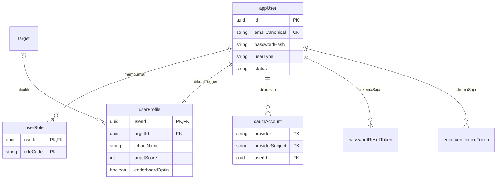
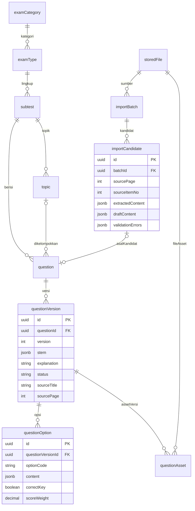
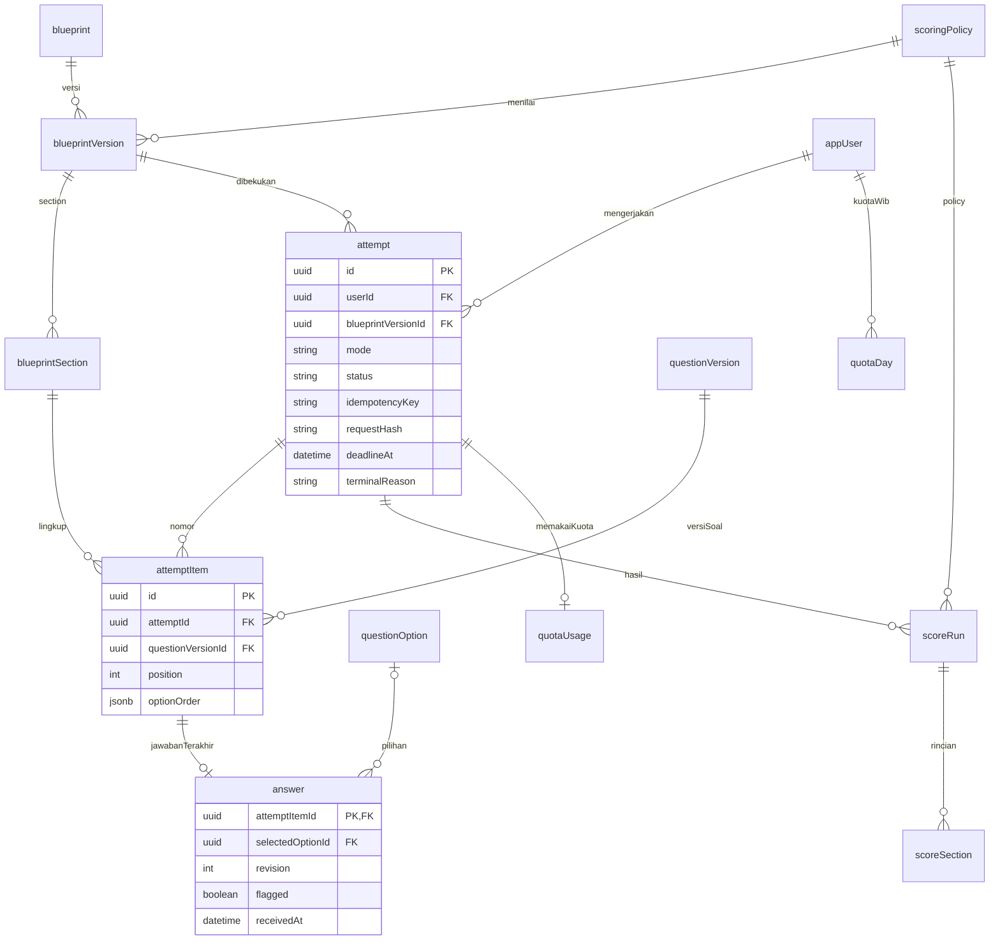
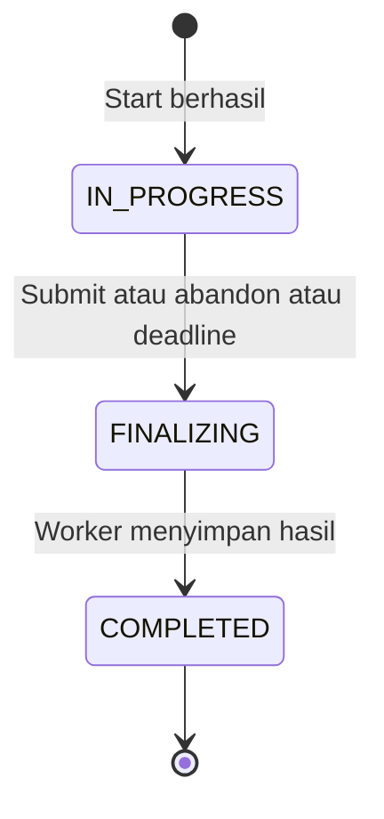
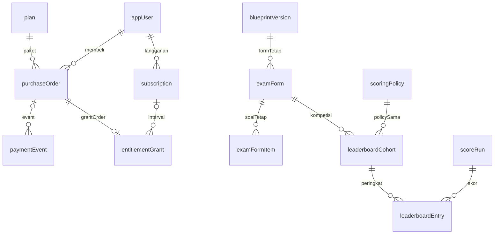

# Model data, struktur JSON dan ERD

[Indeks dokumentasi](README.md) · [Kamus kolom lengkap](database-dictionary.md)

Skema aplikasi terdiri dari 40 tabel pada migrasi V1–V6, di luar `flyway_schema_history`.
ERD di bawah memakai nama camelCase untuk keterbacaan; nama tabel SQL padanannya adalah snake_case.
Diagram menunjukkan relasi utama, sedangkan seluruh foreign key/composite constraint ada pada kamus tabel.

## Identity dan profil



- `email_canonical` menyimpan email untuk lookup unik; service menormalisasi lowercase/trim.
- `password_hash` berupa BCrypt, dapat NULL pada akun SSO; tidak pernah menjadi field response.
- `user_type` default SISWA adalah tipe produk, sementara role berasal dari relasi `user_role`.
- `oauth_account` mengenali identitas eksternal dengan pasangan provider+subject, bukan email saja.
  Unique user+provider membatasi satu identitas provider yang sama per akun.
- Trigger pembuatan akun menambahkan `user_profile`. Update profil menyinkronkan display name akun/profil.
- TargetKind tersimpan sebagai CAMPUS/CIVIL_SERVICE/ACADEMY/SCHOOL, hasil mapping dari kategori form siswa.
- Token reset/verifikasi mempunyai hash dan expiry, tetapi flow endpoint/mail belum tersedia.

## Konten, asal file dan versi



`question` adalah identitas keluarga soal: subtes, topik, kode, asal kandidat dan archive timestamp.
Konten ada pada `question_version`; opsi juga terikat pada versi. Edit terbit membuat versi baru, bukan
mengubah versi lama. Pool memilih versi PUBLISHED terbaru; versi DRAFT yang lebih baru tidak ikut pool.
Soal diarsipkan pada keluarga question, sehingga sesi baru tidak memilihnya, sementara sesi lama tetap dapat dibaca.

Sumber PDF disimpan satu kali per upload yang diterima, bukan disalin per pengguna/attempt. `stored_file` memuat
path relatif, checksum, ukuran, MIME, pengunggah, original name dan purpose. `import_batch` memuat scope dan
hitungan kandidat; `import_candidate` menyimpan asal halaman/item, ekstraksi asli dan draft koreksi terpisah.
Unique batch+page+item membuat commit ekstraksi ulang idempoten. Unique question.candidate_id menjaga satu keluarga
soal per kandidat yang disimpan. Tidak ada penggabungan otomatis terhadap soal berteks mirip dari file berbeda.

### Tiga bentuk data soal yang berbeda

Database `question_version.stem` dan `question_option.content`:

```json
{"text":"Berapa hasil 2 + 3?"}
```

Request authoring/kandidat berupa konten terstruktur dengan opsi dan kunci:

```json
{
  "stemText": "Berapa hasil 2 + 3?",
  "options": [
    {"code":"A","text":"4","correct":false,"weight":0},
    {"code":"B","text":"5","correct":true,"weight":1}
  ],
  "explanation": "Dua ditambah tiga sama dengan lima.",
  "shuffleAllowed": false
}
```

Response soal siswa saat aktif mempunyai key berbeda dan tidak membuka kunci:

```json
{
  "position": 1,
  "stem": {"text":"Berapa hasil 2 + 3?"},
  "options": [
    {"id":"00000000-0000-4000-8000-000000000011","code":"B","content":{"text":"5"},"correct":null},
    {"id":"00000000-0000-4000-8000-000000000012","code":"A","content":{"text":"4"},"correct":null}
  ],
  "selectedOptionId": null,
  "flagged": false,
  "revision": 0,
  "correct": null,
  "explanation": null
}
```

`code` adalah kode opsi master, `id` adalah identitas database opsi, dan posisi tampil berasal dari snapshot.
Frontend mengirim `selectedOptionId`, bukan huruf berdasarkan urutan tampilan.
`correct=null` bisa berarti hasil belum tersedia atau soal kosong; periksa status attempt dan selectedOptionId.

## Blueprint, snapshot, jawaban dan hasil



`blueprint` adalah identitas paket yang ditampilkan katalog; `active_version_id` memilih konfigurasi aktif.
`blueprint_version` mengikat durasi dan scoring policy; section mengikat subtes/jumlah/filter.
Practice memakai mode PRACTICE pada blueprint internal yang tidak muncul di katalog TRYOUT.

Snapshot **berupa referensi ke versi immutable**, bukan salinan seluruh JSON soal pada setiap attempt.
`attempt_item` membekukan question ID, version ID, section, nomor dan urutan kode opsi. Contoh `option_order`:

```json
["B","A","D","C"]
```

`answer` menyimpan jawaban terakhir per item beserta revision, bukan event log seluruh perubahan jawaban.
Belum ada tabel event untuk merekonstruksi semua autosave sebelumnya. Jam `received_at` berasal dari server/database.
Revision 0 berarti belum ada record jawaban; insert pertama revision 1. Update stale ditolak.

Contoh filter section yang dipahami use case saat ini:

```json
{"topicId":"00000000-0000-4000-8000-000000000021","sourceYear":2026}
```

Kedua field opsional. Filter lain ditolak saat start. Konfigurasi filter belum dibuat lewat API admin.

Contoh policy/rincian skor:

```json
{"correctPoints":1,"wrongPoints":0,"emptyPoints":0}
```

```json
{"label":"Indeks latihan PastiSiap; bukan skor resmi","correct":2,"wrong":0,"empty":1}
```

Policy adalah data terversi yang direferensikan blueprint dan hasil. Hasil menyimpan policyVersion, input hash,
total dan rincian subtes. Unique hasil mendukung koreksi terversi di schema, tetapi API koreksi/regrade belum ada.
Service normal menghasilkan satu score run dan mengembalikan hasil terbaru. `correction_version` default 1.

### Lifecycle yang dipakai service



Terminal reason terpisah dari status. ABANDONED/TIMED_OUT saat ini adalah reason yang disimpan pada attempt,
bukan status akhir yang harus ditunggu UI. Job gagal permanen tidak otomatis membuat status attempt FAILED.
UI menunggu COMPLETED untuk review dan perlu menampilkan pemrosesan jika score masih null.

## Commerce dan kompetisi yang masih sebagian



Diagram ini menunjukkan **relasi schema**, bukan flow pembayaran/kompetisi yang sudah aktif.
Order menyimpan snapshot paket; satu order hanya boleh mempunyai satu entitlement grant. Event provider unik
mendukung dedup webhook yang akan dibangun. Nilai uang memakai `amount_minor BIGINT` + currency; belum ada API
untuk checkout atau konversi minor unit. Read subscription mengecek grant yang aktif, tidak cukup status langganan saja.

Kompetisi membutuhkan form tetap dan policy sebanding. Constraint leaderboard memeriksa kesesuaian form,
score, pengguna dan opt-in. Sesi acak saat ini tidak memiliki form/cohort yang otomatis di-enroll.

## Struktur job, audit dan file

Contoh payload job, tanpa password/token atau seluruh isi file:

```json
{"attemptId":"00000000-0000-4000-8000-000000000031"}
```

```json
{"batchId":"00000000-0000-4000-8000-000000000041"}
```

`type` menentukan dispatcher SCORE_ATTEMPT/IMPORT_PDF. `dedup_key` seperti `score:<id>` atau `import:<id>` unik.
Kolom lease_owner, lease_until dan lease_token mengatur kepemilikan proses; retry_count bertambah saat claim.
`last_error` menyimpan kelas exception yang aman, sedangkan detail penyebab ada di log.

Batch dan job mempunyai status berbeda: batch dapat QUEUED/READY/NEEDS_INPUT/FAILED; status pekerjaan dapat
QUEUED/PROCESSING/RETRY_WAIT/SUCCEEDED/FAILED. Batch tidak harus mendapat nilai PROCESSING saat worker sedang berjalan.
READY berarti kandidat lengkap menurut validator, **bukan** seluruh soal sudah dipublish.

`audit_event` dapat menampung aktor, aksi, entity, timestamp dan before/after tersensor.
Implementasi konten saat ini hanya mengisi sebagian field/aksi; request_id dan before/after tidak otomatis
terisi pada semua audit. Jangan menganggap audit_event sudah menjadi event sourcing seluruh sistem.

Layout file saat ini:

```text
storage/
  imports/<uuid>.pdf           # sumber PDF privat, metadata di stored_file
  demo/sample-questions.pdf    # fixture dari profil demo, bukan asset siswa otomatis
```

`relative_path` direkonstruksi melalui adapter yang memeriksa normalisasi/realpath. Nama file pengguna tidak
menentukan lokasi simpan. File asli tetap bisa berisi data sensitif/kunci dan hanya disediakan lewat handler petugas.

## Aturan integritas penting

| Mekanisme | Yang dijaga |
|---|---|
| Email canonical unique | Tidak ada dua akun dengan email lookup sama |
| Composite topic/subtest FK | Topik question/import tidak keluar dari lingkup subtes |
| Active version composite FK | Pointer blueprint menunjuk versinya sendiri |
| Guard section | Subtes section cocok exam type blueprint |
| Guard snapshot | Versi PUBLISHED cocok question, section dan blueprint attempt |
| Unique attempt/question dan attempt/position | Tidak ada soal/nomor ganda dalam satu snapshot |
| Partial unique active attempt | Satu IN_PROGRESS/FINALIZING per pengguna |
| Unique user/idempotency key | Replay start tidak membuat sesi kedua |
| FK selected option dan guard answer | Opsi cocok versi; state/deadline/revision diperiksa |
| Immutable guards | Versi/opsi terbit, blueprint/policy aktif/terpakai tidak diedit sembarang |
| attempt_item UPDATE/DELETE guard | Snapshot yang ada tidak diganti/dihapus melalui update biasa |
| question_asset guard | Source PDF tidak menjadi asset siswa; asset versi terbit tidak dimutasi |
| quota_usage PK attempt + owner FK | Pemakaian kuota cocok pengguna dan sekali per attempt |
| job dedup + lease | Tidak ada dua job logis dengan dedup key sama; commit worker lama dibatasi |

Guard tersebut melengkapi transaksi service; tidak semua aturan produk merupakan CHECK database.
Batas kuota 2/hari juga ditegakkan service dengan lock akun. Akun database dengan hak mengubah schema tetap
dapat menonaktifkan guard, sehingga operasi langsung ke database harus dibatasi pada operator yang berwenang.

## Konvensi tipe data dan evolusi

- UUID dikirim sebagai string UUID pada JSON, diparameterkan sebagai UUID pada JDBC.
- Timestamp memakai TIMESTAMPTZ/UTC, response ISO-8601; tanggal kuota eksplisit Asia/Jakarta.
- Skor dan bobot NUMERIC/BigDecimal; jangan menghitung ulang score resmi di browser.
- JSONB dipakai untuk konten fleksibel, filter, payload dan detail; identitas/relasi utama tetap kolom/FK.
- Array list kosong sah. Nilai NULL punya makna berbeda dengan 0 atau string kosong.
- Migrasi V1–V6 immutable. Tambahkan V7+ untuk perubahan schema berikutnya; jangan memakai ddl-auto=update.
- Pemindahan disk ke object storage dapat dilakukan lewat port storage, namun pengaturan URL/ACL, backup
  dan migrasi file yang sudah ada tetap perlu dikerjakan secara eksplisit.
